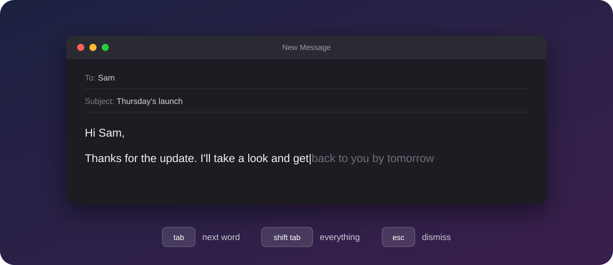
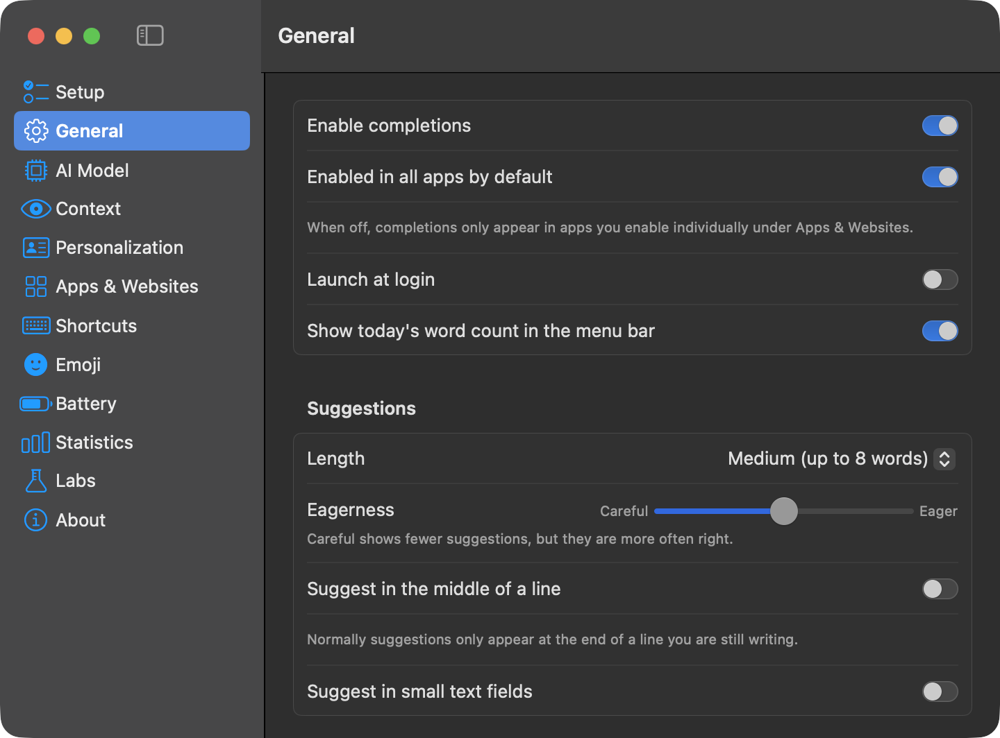
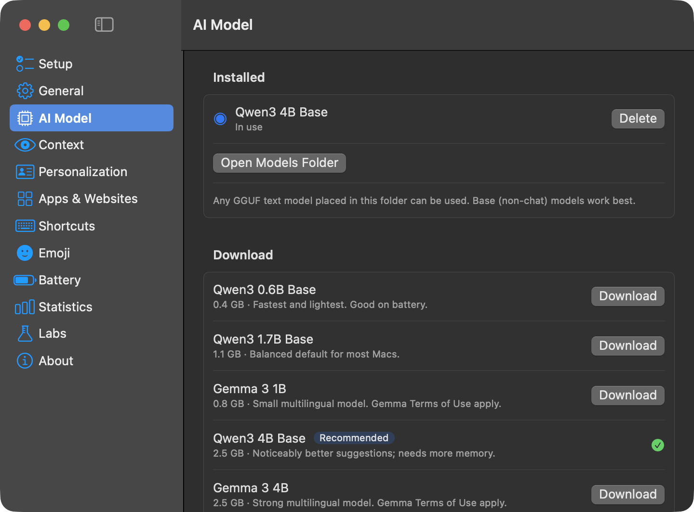

<h1 align="center">Typist</h1>

<p align="center">
  <b>Open-source inline AI autocomplete for macOS.</b><br>
  Suggests your next words in any app. Runs entirely on your Mac.
</p>

<p align="center">
  
  
  
  
</p>

<p align="center">
  
</p>

Typist sits in your menu bar and shows the next few words as grey "ghost text"
right at your caret — in Mail, Notes, Slack, your browser, chat apps. Press
<kbd>Tab</kbd> to take a word, keep typing to ignore it. The language model runs
locally through [llama.cpp](https://github.com/ggml-org/llama.cpp): no account,
no cloud, no telemetry, and it works offline.

| Key (default) | Action |
| --- | --- |
| `Tab` | Accept the next word (or the offered emoji / typo fix) |
| `Shift` + `Tab` | Accept the whole suggestion |
| `Esc` | Dismiss |
| keep typing | Typing what was suggested keeps the rest on screen |

All shortcuts can be changed in Settings.

## Features

- **Inline completions** in any app that exposes its text through the
  Accessibility API, with adjustable length and eagerness, optional mid-line
  suggestions, and confidence gating so weak guesses are never shown
- **Context**: app name, window title and field placeholder; optionally the text
  visible in the window (on-device OCR) and the clipboard
- **Personalization**: your own instructions, plus optional learning from what
  you write (stored locally, deletable, secrets redacted)
- **Per-app and per-website settings**: on/off, leave Tab to the app, extra
  instructions, mid-line, text size and offset
- **Pausing**: for a few minutes, per app, via Escape, or by global shortcut;
  automatic while macOS Secure Input is active
- **Emoji**: type `:joy` and press Tab; preferred skin tone
- **Typo guard**: holds back suggestions after a likely typo and offers the fix
- **Word alternatives** (Labs): pick another word by number, for a selected
  word or for the next suggested word
- **Battery**: shorter completions or a full pause on battery power
- **Statistics**: words completed, acceptance rate, 14-day chart; optional
  word count in the menu bar
- **Models**: built-in catalog with a recommendation for your Mac, or drop any
  GGUF file into the models folder
- **Launch at login**, guided first-run setup

## Screenshots

| General | AI Model |
| --- | --- |
|  |  |

## Requirements

- macOS 14 or later, Apple Silicon recommended
- Swift 5.10+ (Xcode or the Command Line Tools)

## Build and run

```bash
Scripts/bundle.sh
```

```bash
open build/Typist.app
```

On first launch:

1. Grant **Accessibility** access when asked (System Settings → Privacy &
   Security → Accessibility). Typist needs it to read the text field you are
   typing in, see key presses, and type accepted suggestions.
2. Download a model from the Setup pane that opens (or Settings → AI Model).
   Any GGUF text model placed in `~/Library/Application Support/Typist/Models`
   can be selected there too. Base (non-chat) models work best.

`Scripts/bundle.sh` signs ad hoc by default, which makes macOS ask for
Accessibility access again after every rebuild. Set `SIGN_IDENTITY` to a stable
signing identity to avoid that.

Useful when developing:

- `defaults write org.typist.Typist debugLog -bool YES` writes a diagnostic log
  to `~/Library/Logs/Typist.log` (lengths and timings only, never your text).
- `open build/Typist.app --args --settings model` opens Settings on a given pane.

Try a model without the UI:

```bash
build/Typist.app/Contents/MacOS/Typist --complete "The capital of France is"
```

## Tests

```bash
Scripts/test.sh
```

## How it works

See [docs/ARCHITECTURE.md](docs/ARCHITECTURE.md).

## Known limitations

- Apps that don't expose their text through the Accessibility API (some
  terminals, Google Docs without its accessibility mode, a few custom editors)
  get no suggestions.
- Ghost text uses the system font sized from the caret height, so it won't
  exactly match the host app's font or color (text size and offset can be
  tuned per app).
- Word alternatives work on single words.
- No sync between Macs and no automatic updates.
- Building with only the Command Line Tools works; `@State` is spelled
  `@ViewState` in the settings UI for that reason (see `SettingsView.swift`).

## License

MIT — see [LICENSE](LICENSE). llama.cpp is MIT licensed. Models are downloaded
separately and have their own licenses.

## Contributing

Issues and pull requests are welcome. `docs/ARCHITECTURE.md` explains how the
pieces fit together and lists ideas to pick up. Please run `Scripts/test.sh`
before opening a pull request.

Typist is an independent project, written from scratch. It is not affiliated
with any commercial autocomplete product.
